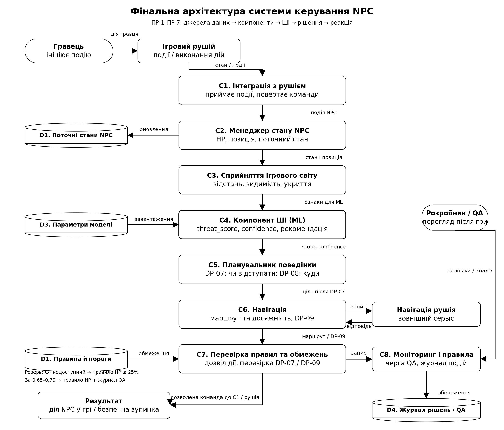

# Інтелектуальна система керування поведінкою NPC

Навчальний фінальний проєкт за практичними роботами **ПР-1–ПР-7** з предмета «Штучний інтелект».  
**Дем'яненко Микола, група 242 2.**

## Problem — проблема

У відеоіграх NPC із жорстко прописаними діями не завжди враховують небезпеку, відстань до гравця та свій стан. Це може призводити до невдалих атак, недоречної втечі й передбачуваної поведінки. Потрібна система, що оцінює ситуацію та діє за зрозумілими обмеженнями.

## Users — користувачі

- **Гравець** бачить реакцію NPC на свої дії.
- **Розробник гри** встановлює правила та перевіряє сценарії.
- **QA-тестувальник** переглядає журнали помилок і сумнівних оцінок.
- **Ігровий рушій** — зовнішня система, яка передає стан гри та виконує команди.

## Solution — рішення

Проєкт передбачає вісім компонентів, які отримують стан гри, визначають видимість і відстань, оцінюють загрозу, обирають допустиму дію та передають команду рушію. Для сценарію **UC-04 «Відступити у разі небезпеки»** реалізовано працюючий *автономний Python-прототип оцінювання загрози та рекомендації дії*.

> **Важливо:** прототип не є повноцінною грою: немає підключення до Unity/іншого рушія, анімації, NavMesh та реалізації всіх 8 сценаріїв. Повну поведінку NPC, навігацію DP-08/DP-09 й виконання команд спроєктовано, але ще не запрограмовано.

## Architecture — архітектура



| Код | Компонент | Основна роль |
|---|---|---|
| C1 | Інтеграція з рушієм | Вхідні події та перевірені команди |
| C2 | Менеджер стану NPC | Здоров'я, координати, стан персонажа |
| C3 | Сприйняття світу | Відстань, видимість, укриття |
| C4 | Компонент ML | Оцінка `threat_score` і `confidence` |
| C5 | Планувальник поведінки | DP-07, вибір дії й цілі відступу |
| C6 | Навігація | DP-08/DP-09, доступність маршруту |
| C7 | Правила й обмеження | Заборони, резервні умови, контроль дії |
| C8 | Налаштування й моніторинг | Параметри, журнали, післяігровий огляд QA |

**Сховища:** D1 — правила/пороги, D2 — стани NPC, D3 — модель ML, D4 — журнал рішень. Розгорнутий зв'язок ПР-1–ПР-7 і DP-01–DP-14: [docs/traceability.md](docs/traceability.md).

## AI component — роль ШІ

**Задача:** оцінити ймовірність високої загрози для NPC. **Підхід:** гібридний, `RandomForestClassifier` + правила `Rule-based`.

Модель отримує з C3: `health_pct`, `distance_m`, `enemy_strength`, `player_visible`, `cover_available`; повертає `threat_score` (оцінка класу високої загрози) і `confidence` (максимальна оцінка класу). Значення **не калібровані** і не гарантують правильності.

Планувальник C5 і правила C7 використовують оцінку в **DP-07**: відступ можливий, якщо він дозволений та `HP ≤ 25%` **або** `threat_score ≥ 0.85`. Код `src/npc_ai.py` повертає сукупний результат C4 + C5/C7 як рекомендацію; **він не передає команду рушію**.

Після ПР-7 встановлена обережніша політика використання результатів:

| Умова | Поведінка системи |
|---|---|
| `confidence ≥ 0.80`, дані коректні | Можна автоматично застосувати оцінку після перевірки правил C7 |
| `0.65 ≤ confidence < 0.80` | Резервне правило за HP; запис для **післяігрової** перевірки QA |
| `confidence < 0.65`, збій C4 | Відхилити оцінку ML; резервне правило за HP за наявності даних |
| Немає критичних даних / некоректні значення | Не запускати нову дію; безпечна зупинка й журнал |
| Дію заборонено сюжетом | C7 блокує дію незалежно від ML |

Пороги — навчальні проєктні правила, а не перевірені межі безпеки для готової гри. У грі **не чекають** ручного підтвердження дій NPC; QA перевіряє проблемні випадки пізніше. Детальніше: [docs/decision_policy.md](docs/decision_policy.md).

## Prototype — що реалізовано

- Синтетичний набір з **400 записів**, детермінована генерація `seed = 42` (300 для навчання, 100 для тесту).
- Навчання `RandomForestClassifier`, оцінювання `threat_score` та `confidence`.
- Перевірка вхідних даних, правила відступу, заборона втечі, fallback.
- Оновлена політика ПР-7: автоматичне рішення / асинхронний QA / відхилення ML.
- Відтворювані **16 контрольних сценаріїв** і **6 автоматизованих тестів**.
- Оригінальний Notebook ПР-6 збережено в [notebooks/PR6_NPC_Prototype.ipynb](notebooks/PR6_NPC_Prototype.ipynb). Фінальний код у `src/npc_ai.py` розширює політику, але не замінює архітектурний проєкт повної гри.

### Як запустити

Рекомендовано **Python 3.11+**. Результати нижче відтворено з Python та версіями бібліотек, зазначеними в `docs/test_environment.txt`. На інших версіях ML-метрики можуть трохи відрізнятися. У кореневій папці репозиторію:

```bash
python -m pip install -r requirements.txt
python -m scripts.evaluate
python -m unittest discover -s tests -v
python -m scripts.demo
```

Команда `scripts.evaluate` повторно створює набір `data/synthetic_npc_400.csv` і таблиці у `results/`. Для Notebook потрібен Jupyter або Google Colab з бібліотеками з `requirements.txt`.

## Results — результати тестування

| Показник | Отримано |
|---|---:|
| Точність ML на 100 відкладених синтетичних записах | **91/100 = 91,0%** |
| Повнота виявлення високої загрози | **28/36 = 77,8%** |
| Матриця помилок | TN=63, FP=1, FN=8, TP=28 |
| Контрольні сценарії після перевірки правил | **16/16** |
| Автоматизовані перевірки | **6/6** |

Ці цифри відтворені запуском коду, але не доводять надійність у реальній грі. 16/16 — результат на **спеціально підготовлених** сценаріях, не загальна точність моделі. Дані: [results/metrics.json](results/metrics.json), [results/controlled_scenarios.csv](results/controlled_scenarios.csv), [results/misclassified_threats.csv](results/misclassified_threats.csv).

## Limitations — обмеження

1. Навчальні мітки створено простою формулою, а не на основі реальних ігрових подій.
2. З 36 випадків високої загрози модель пропустила **8**; `confidence` не каліброване.
3. Пороги 0.80 / 0.65 обрані після перевірки лише на 100 тестових записах, тож їх треба перевірити на нових даних.
4. Навігація, виконання руху NPC, реальний інтерфейс QA і збереження моделі як окремої служби не реалізовані.

## Future development — наступні кроки

1. Зібрати й розмітити логи реальної гри, перевірити коректність поділу на train/test.
2. Покращити повноту високої загрози, калібрувати оцінки моделі та повторно вибрати пороги на незалежній вибірці.
3. Під'єднати C4 до C3/C5/C7 у рушії через локальний виклик або API; реалізувати DP-08/DP-09 з NavMesh.
4. Реалізувати C8/D4 для журналювання рішень і післяігрового перегляду QA.

## Матеріали проєкту

- [docs/architecture_final.svg](docs/architecture_final.svg) — масштабована архітектурна схема; [Mermaid-код](docs/architecture_final.mmd).
- [docs/traceability.md](docs/traceability.md) — відповідність ПР-1–ПР-7 і всіх DP.
- [docs/decision_policy.md](docs/decision_policy.md) — логіка довіри до ML.
- [docs/PR8_Final_Report.pdf](docs/PR8_Final_Report.pdf) — фінальний звіт.
- [docs/previous_practicals](docs/previous_practicals) — наявні вихідні матеріали ПР-3–ПР-7.

Інструкція з публікації: [docs/PUBLISH_GITHUB.md](docs/PUBLISH_GITHUB.md). Для повторного створення PDF/діаграми, на відміну від запуску моделі, потрібні додаткові бібліотеки з `requirements-build.txt`.

У README й звіті описано **реалізований навчальний прототип та спроєктовану майбутню систему** — це різні рівні готовності.
